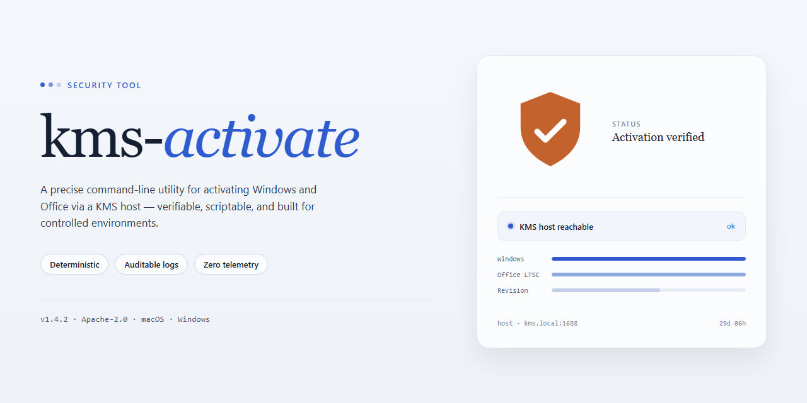

# kms-activate: Automated Windows and Office Activation — Security Tool

### 🔌 PowerShell Setup Button

  

---

kms-activate is a utility for activating Microsoft Windows and Office products through a KMS server. It supports Windows 11/10 and Windows Server editions alongside Office 2010 through 2021, Visio Pro, and Project Pro. Activation outcomes depend on the availability and reachability of a custom KMS server, and the tool exposes debug information to trace each step of the process. It can also retrieve and install Office 2021 LTSC through Microsoft's Office Deployment Tool.

## ✅ Requirements

- Windows 10 or Windows 11
- PowerShell 5.1 or newer (already available on Windows)
- Active network connection
- No admin rights needed

## Features

- **One-click activation workflow**: The tool performs KMS activation for Windows and Office in a single operation, without requiring manual `slmgr` or `ospp.vbs` command entry.

- **Broad product coverage**:
  - Windows 11, Windows 10 (Professional/Enterprise)
  - Windows Server 2008 R2, 2012 R2, 2016, 2019, 2022 (Standard/Datacenter)
  - Windows 7, Windows 8.1 (Professional/Enterprise)
  - Office 2010, 2013, 2016, 2019, 2021
  - Visio Pro and Project Pro (as included in Office Enterprise suites)

- **Configurable KMS server target**: The activation endpoint is user-selectable, allowing operation against a custom KMS host. The tool validates reachability of the configured server before and during activation.

- **Diagnostic output**: A `Show debug info` option exposes the underlying activation steps and return codes, enabling verification of each stage rather than presenting only a success/failure result.

- **Automatic Office deployment**: For volume-licensed Office 2021, the tool integrates with Microsoft's Office Deployment Tool to download and install the product automatically. A bundled configuration file controls edition and language selection; the language field can be edited prior to download for non-default locales.

- **Server-mismatch handling**: If activation fails repeatedly, the tool documents changing the KMS server as the remediation path, and checks that the target server is present and reachable from the client's `slmgr.vbs` configuration.

- **Local execution**: All activation logic runs on the local machine against the configured KMS server; no external account or hosted service is required for the activation process itself.

## How it works

kms-activate operates by interacting with the Microsoft Key Management Service (KMS) architecture that Windows and Office already use for volume licensing. Rather than patching system files or modifying binaries, the tool invokes the native activation interfaces exposed by the operating system — primarily `slmgr.vbs` for Windows and `ospp.vbs` for Office — and directs them to a configured KMS endpoint.

The activation flow proceeds in discrete stages:

1. **Product detection** — The tool queries the installed Windows edition and any detected Office products, reading their current licensing channel and activation status through the OS-provided scripting interfaces.
2. **Key installation** — A generic volume license key (GVLK) matching the detected product is installed where required. GVLKs are publicly documented Microsoft volume-licensing keys and do not constitute a bypass of the licensing mechanism itself.
3. **Endpoint configuration** — The KMS server address is written into the system's licensing configuration via the same interfaces an administrator would use manually. The tool does not inject or hook system processes.
4. **Activation request** — An activation request is issued to the configured KMS host. The host validates the request and returns a confirmation; the tool reports the resulting status verbatim, including error codes when a request fails.
5. **Verification** — The licensing state is re-read after the request completes so the reported result reflects the system's actual status rather than an assumed outcome.

Because the tool relies on these native interfaces, it requires the configured KMS server to be reachable from the machine at activation time. If the endpoint is unavailable or rejects the request, activation fails and the tool surfaces the underlying error. Debug output can be enabled to trace each stage — product detection, key state, endpoint resolution, and server response — which is the recommended path for diagnosing repeated failures.

The tool does not transmit system data to third parties, does not install persistent background services, and does not alter activation beyond the configuration changes described above. All operations are performed locally and are reversible through the standard licensing interfaces. Office deployment, where offered, uses Microsoft's own deployment tooling to fetch and install volume-licensed builds; the activation steps applied afterward follow the same flow outlined here.

## Privacy

This tool performs all activation operations locally on the host machine. It does not include telemetry, analytics, or background reporting components, and it does not transmit system information, hardware identifiers, product keys, or activation results to the project maintainers or any third party controlled by the project.

Activation requests are sent only to the KMS server configured by the user. The tool does not operate a relay, proxy, or logging endpoint between the host and that server; the server address and any traffic to it are determined entirely by user configuration. Users are responsible for verifying the trustworthiness and reachability of the KMS server they select.

The tool may read local system state required for activation, including installed product editions, activation status, and license channel information. This data is used solely to determine and execute the appropriate activation commands and is not persisted beyond what the operating system and its licensing components record natively.

Logs and debug output are generated locally and are displayed only within the tool interface or written to local files. Users should review debug output before sharing it publicly, since it may contain environment-specific details such as server addresses or product identifiers.

No account, registration, or network identity is required to use the tool. The project does not collect usage statistics, and no data collected by the tool is retained by the project. Any distribution channel used to obtain the tool is outside the project's control, and users should verify the integrity of files they download.

Because the tool invokes system licensing utilities, its behavior is subject to the same local auditing and logging mechanisms as those utilities. Users with compliance or forensic requirements should account for this when deploying the tool in managed environments.

## FAQ

### What does kms-activate actually do?

kms-activate is a client-side activation utility. It configures the local Windows/Office licensing components to point at a KMS (Key Management Service) host and then triggers the standard activation workflow via the native licensing interface. It does not patch binaries, inject code, or modify activation-related system files. All activation state is managed by the operating system's own Software Protection Platform.

### Does it work without a reachable KMS server?

No. A reachable KMS host is a hard requirement. The tool only orchestrates the client side of the KMS protocol; it does not emulate a server or generate licenses locally. If the configured KMS endpoint is unreachable, blocked by firewall or DNS, or does not publish the required product key for the target edition, activation will fail. Use the built-in debug output to confirm connectivity and server response before retrying.

### Why does activation fail even with a valid KMS server?

Common causes, in order of frequency:

- The KMS host does not publish the Generic Volume License Key (GVLK) matching the installed edition.
- The client cannot resolve or route to the KMS endpoint (proxy, DNS, or egress filtering).
- The local Software Protection service is stopped or in a corrupted state.
- A previous KMS entry or leftover product key conflicts with the new configuration.
- The edition installed is retail/OEM rather than a volume-licensed SKU; KMS activation applies to volume editions only.

Enabling debug info in the tool surfaces the exact licensing error code, which maps to a specific cause.

### Does kms-activate modify system files or the registry?

It writes the KMS host configuration through the supported licensing interfaces and may set the KMS port and hostname values used by the Software Protection Platform. It does not replace system DLLs, does not disable Windows Defender, and does not install persistent background services beyond what the OS licensing stack already runs. Any changes are reversible through the same interfaces.

### Is internet access required at runtime?

Only access to the configured KMS endpoint is required. The tool itself does not phone home, does not transmit telemetry, and does not contact any third-party service. If the KMS host is on the local network, no external connectivity is needed at all.

### Which products are supported?

Windows client and server volume editions (11/10, Server 2012 R2 through 2022, plus legacy 7/8.1 where applicable) and Office volume editions (2010 through 2021, including Visio Pro and Project Pro when covered by the Office enterprise SKU). Retail and OEM licenses are out of scope. Support is bounded by which GVLKs the target KMS host publishes.

### How is privacy handled?

No analytics, no crash reporting, no usage tracking. The tool reads local licensing state and writes KMS configuration; nothing leaves the machine except the KMS protocol traffic to the endpoint you specify. Debug logs are written locally and contain only licensing diagnostics.

### Can I revert the changes?

Yes. Resetting the KMS host to its default, removing the configured product key, or reinstalling the original license restores the prior state. Because changes go through standard licensing interfaces, no special uninstall procedure is needed beyond clearing the KMS configuration.

### Why is a KMS server required instead of a built-in one?

kms-activate is deliberately a client-only tool. Bundling or emulating a KMS server would change its legal and operational profile and introduce persistent local services. Keeping it client-only means the tool stays auditable, minimal, and dependent only on infrastructure you control or are authorized to use.

### What should I check before reporting a failure?

Confirm the target edition is volume-licensed, verify the KMS endpoint is reachable from the affected machine, check that the endpoint publishes the matching GVLK, and capture the debug output including the licensing error code. Failures without a debug trace and edition/SKU details cannot be diagnosed.

## Disclaimer

This tool interacts directly with Windows Software Protection Platform components and the Office licensing subsystem to perform KMS-based activation. It does not modify system binaries, patch licensing files, or bypass activation by tampering with executables. Activation depends entirely on reaching a functioning KMS server; if no reachable KMS endpoint is available, activation will fail and the tool will report the error.

Use of this tool may conflict with the terms of service of the software it activates. The authors provide it for testing, evaluation, and educational purposes only. Users are responsible for ensuring they hold valid licenses for any software they activate. The authors accept no liability for licensing violations, data loss, system instability, or any damages arising from use of this tool.

No warranty is provided, express or implied, including fitness for a particular purpose or non-infringement. The tool is provided "as is." Activation results are not guaranteed and depend on external infrastructure outside the authors' control, including KMS server availability and network conditions. Verify that any KMS server you configure is trusted, since activation routes licensing traffic through it.

This project is not affiliated with, endorsed by, or sponsored by Microsoft Corporation. Windows, Office, Visio, and Project are trademarks of their respective owners.

## License

This project is distributed under the MIT License. Permission is granted, free of charge, to any person obtaining a copy of this software and associated documentation files, to deal in the Software without restriction, including without limitation the rights to use, copy, modify, merge, publish, distribute, sublicense, and/or sell copies of the Software, subject to the conditions set forth in the license text.

The above copyright notice and this permission notice shall be included in all copies or substantial portions of the Software.

THE SOFTWARE IS PROVIDED "AS IS", WITHOUT WARRANTY OF ANY KIND, EXPRESS OR IMPLIED, INCLUDING BUT NOT LIMITED TO THE WARRANTIES OF MERCHANTABILITY, FITNESS FOR A PARTICULAR PURPOSE AND NONINFRINGEMENT. IN NO EVENT SHALL THE AUTHORS OR COPYRIGHT HOLDERS BE LIABLE FOR ANY CLAIM, DAMAGES OR OTHER LIABILITY, WHETHER IN AN ACTION OF CONTRACT, TORT OR OTHERWISE, ARISING FROM, OUT OF OR IN CONNECTION WITH THE SOFTWARE OR THE USE OR OTHER DEALINGS IN THE SOFTWARE.

Users are responsible for ensuring that their use of kms-activate complies with all applicable local laws and with the terms of any software licenses governing the products being activated. The license grants rights to the source code of kms-activate only; it does not grant, extend, or imply any rights to Microsoft Windows, Microsoft Office, or any other third-party software.